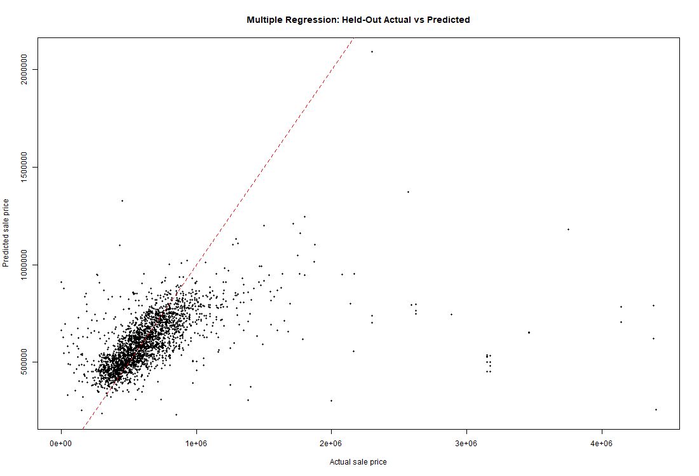
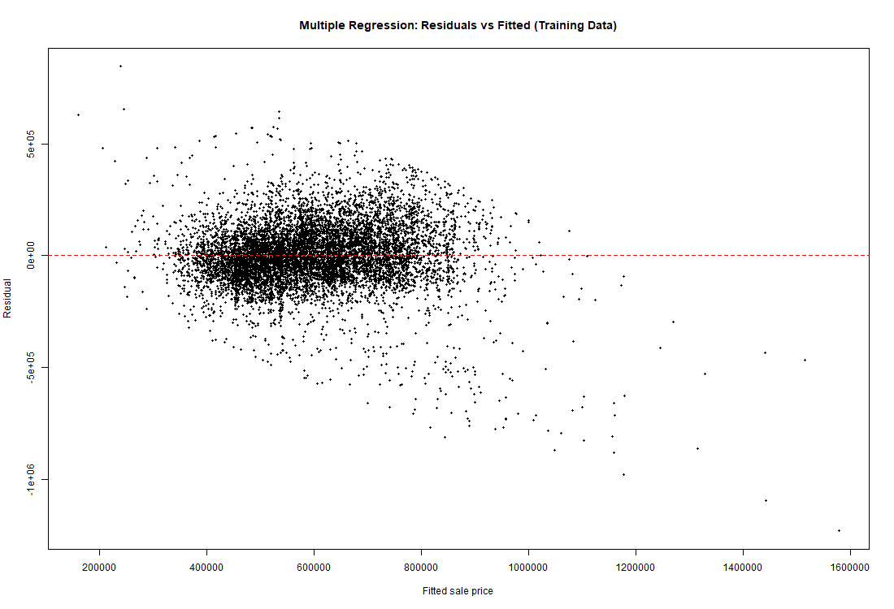
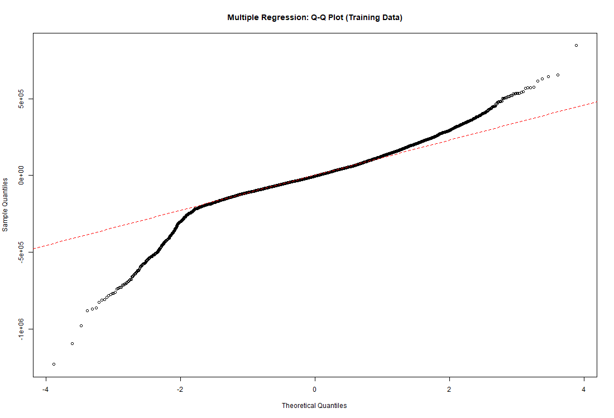

<h1 align="center">Housing Price Regression Analysis Using R</h1>

<p align="center"><strong>R Programming | Statistical Modeling | Data Preparation | Regression Diagnostics | Predictive Analytics</strong></p>

<p align="center">An end-to-end housing price analysis comparing simple and multiple linear regression models using reproducible R code and holdout evaluation.</p>

---

## Project Overview

This project uses R to analyze residential housing sale prices, investigate relationships with property characteristics, and compare simple and multiple linear regression models on previously unseen data.

Originally developed through graduate-level coursework at Bellevue University, the analysis was refined into a separate portfolio script with consistent model specifications, a training/test split, and exported diagnostic results.

**Project Type:** Predictive Analytics and Statistical Modeling  
**Programming Language:** R  
**Dataset:** Residential housing sales  
**Source Records:** 12,861  
**Evaluation Method:** 80/20 training and testing split  
**Repository:** [housing-price-regression-r](https://github.com/crisevilindsey/housing-price-regression-r)

## Business Problem

Housing prices depend on multiple property characteristics. This project investigates whether a multiple regression model using living area, lot size, bedrooms, bathrooms, and construction year predicts sale prices more accurately than a baseline using lot size alone.

### Research Questions

1. How well does lot size alone predict sale prices?
2. Does multiple regression improve holdout prediction accuracy?
3. What do residual diagnostics reveal about model limitations?
4. How can data cleaning and outlier handling support a reproducible analysis?

## Dataset and Data Preparation

The R script reads `week-6-housing.xlsx`, containing 12,861 source records and 24 variables. It:

- Standardizes column names and trims text fields.
- Removes exact duplicate rows.
- Fills missing city names from available postal city values.
- Validates numeric fields and retains complete, valid records for modeling.
- Converts selected categorical fields to factors when present.
- Creates an 80/20 training/test split using a fixed random seed.
- Calculates sale-price IQR outlier thresholds using **training data only** and filters training observations, leaving the test set intact.

The generated `data_preparation_audit.csv` documents row counts and the outlier thresholds used.

## Modeling Approach

### Simple Linear Regression

The baseline predicts sale price using lot size:

```r
simple_model <- lm(sale_price ~ sq_ft_lot, data = train_filtered)
```

### Multiple Linear Regression

The comparison model includes five housing characteristics:

```r
multiple_model <- lm(
  sale_price ~ sq_ft_lot + square_feet_total_living + bedrooms +
    bath_full_count + year_built,
  data = train_filtered
)
```

Both models use the same filtered training observations and are evaluated on the same untouched holdout sample.

## Model Performance

Results from the executed RStudio script, rounded for readability:

| Metric | Simple Linear Regression | Multiple Linear Regression |
|---|---:|---:|
| Holdout observations | 2,573 | 2,573 |
| RMSE | $370,848 | $332,725 |
| MAE | $203,666 | $147,136 |
| R² | -0.001 | 0.195 |

The multiple regression reduced holdout RMSE by approximately **10.3%** and MAE by approximately **27.8%** compared with the simple regression. Its holdout R² of approximately **0.195** indicates meaningful improvement, but also substantial remaining prediction error. These models are not validated for standalone property valuation.

## Statistical Diagnostics and Visualizations

### 1. Actual vs. Predicted Housing Prices

<p align="center">
  
</p>

<p align="center"><em>Figure 1. Actual and predicted housing sale prices for the multiple regression model on the holdout set.</em></p>

The diagonal reference line represents perfect predictions. Deviations from it indicate prediction error.

### 2. Residuals vs. Fitted Values

<p align="center">
  
</p>

<p align="center"><em>Figure 2. Residuals versus fitted values for the multiple regression model on training data.</em></p>

Residual patterns can indicate model misspecification, nonlinearity, unequal error variance, or unusual observations.

### 3. Normal Q-Q Plot

<p align="center">
  
</p>

<p align="center"><em>Figure 3. Normal Q-Q plot of multiple regression training residuals.</em></p>

The Q-Q plot helps assess departures from a normal residual distribution.

### 4. Breusch-Pagan Test

When the optional `lmtest` package is installed, the script runs a Breusch-Pagan test for nonconstant error variance and saves the output to `breusch_pagan_test.txt`. Interpret the test alongside the residual plot.

## Tools and Technologies

| Tool | Use |
|---|---|
| R | Data preparation, modeling, evaluation, and visualizations |
| `readxl` | Importing the source Excel workbook |
| Base R / `stats` | Linear regression, predictions, residual diagnostics |
| `lmtest` (optional) | Breusch-Pagan test |
| RStudio | Script execution and review |
| CSV / PNG / TXT | Reproducible result exports |

## Repository Contents

```text
housing-price-regression-r/
├── README.md
├── Housing_Price_Regression_Portfolio.R
├── breusch_pagan_test.txt
├── data_preparation_audit.csv
├── holdout_actual_vs_predicted.png
├── holdout_model_metrics.csv
├── holdout_predictions.csv
├── model_summaries.txt
├── multiple_model_qq.png
└── multiple_model_residuals.png
```

The source workbook `week-6-housing.xlsx` is required to rerun the script. Its availability in this public repository has not yet been confirmed.

## How to Run

1. Install R and optionally RStudio.
2. Install the required package: `install.packages("readxl")`.
3. Optionally install `lmtest` for the Breusch-Pagan test: `install.packages("lmtest")`.
4. Place `week-6-housing.xlsx` in the working directory, or change `input_file` in the script to its full path.
5. Run the script from the appropriate working directory:

```r
source("Housing_Price_Regression_Portfolio.R")
```

The script creates an `outputs/` directory containing model metrics, predictions, summaries, a preparation audit, and diagnostic plots. The sample outputs in this repository were uploaded to the repository root.

## Reproducibility and Limitations

The script uses `set.seed(680)` for a repeatable data split. Outlier thresholds are calculated only from training data to avoid test-data leakage. Performance metrics are computed on the original holdout distribution, not the filtered training sample.

Limitations include a restricted predictor set, no cross-validation, possible nonlinear effects and heteroscedasticity, and a relatively low holdout R². Geographic and market factors could be explored in future modeling. The results reflect this historical dataset, not current housing market prices.

## Business Applications

The project demonstrates a workflow relevant to property valuation research, predictive analytics, model evaluation, data quality management, and communication of statistical limitations to decision-makers. These are potential applications, not verified business outcomes.

## Project Development

This portfolio implementation is a corrected adaptation of the original Bellevue University coursework. It preserves the original analysis objectives while introducing consistent model specifications, a reproducible training/test split, holdout metrics, and exported diagnostics. The original coursework files remain separate.

## Author

**Criselvi Lindsey**  
Data Analytics and Business Intelligence Leader  
MBA, Business Analytics | M.S. Data Science  
[GitHub Profile](https://github.com/crisevilindsey)

---

<p align="center"><em>Applying statistical modeling and predictive analytics to transform housing data into interpretable business insights.</em></p>
